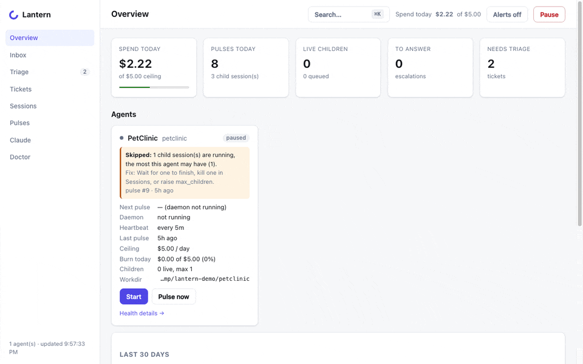

<picture>
  <source media="(prefers-color-scheme: dark)" srcset="docs/media/lantern-ui-dark.gif">
  
</picture>

# Lantern

A local heartbeat orchestrator. A daemon wakes on a schedule, runs a standing
checklist against your repository — scan the logs, read the bug inbox, run the
tests — files what it finds as tickets in a SQLite ledger it owns, staffs the
ones it can handle with Claude Code sessions, and escalates to you only what
needs a decision.

You check in when it suits you: a terminal command or a local web page shows
what it noticed, what it did, what it spent, and what is waiting on you.

```
 every heartbeat ─▶ gates ─▶ collect ─▶ Claude turn ─▶ reap children
                    (budget,   (logs,     (triage,       (record results,
                     quiet      inbox,     staff,          push branches)
                     hours…)    tests)     escalate)
```

> **Status: early.** Tested on macOS with Node 24. Lantern runs Claude Code on
> its own and spends your Claude budget. Read
> [What Lantern does on its own](#what-lantern-does-on-its-own) before you start it.

## Requirements

- **macOS.** Linux should mostly work but is untested (desktop notifications
  are macOS-only). Windows is not supported.
- **Node 24 or later.** Lantern runs its TypeScript directly; there is no build step.
- **[Claude Code](https://claude.ai/code)**, installed and logged in
  (`claude login`), or `ANTHROPIC_API_KEY` exported in the shell that starts Lantern.
- **git.** Optional: `gh` (draft pull requests on GitHub), `sqlite3` (`lantern db`).

## Install

```sh
git clone https://github.com/cleiderg/lantern.git
cd lantern
npm install        # one dependency: better-sqlite3
npm link           # optional — puts `lantern` on your PATH (otherwise: node bin/lantern …)
lantern --version
```

To update: `git pull && npm install`. Your data lives in `~/.lantern`, not in the
clone, and the database upgrades itself.

## Quick start

1. **Set up Lantern's home** (`~/.lantern`, or wherever `LANTERN_DIR` points):

   ```sh
   lantern init
   lantern doctor          # Node, SQLite, Claude Code, auth — fix anything red
   ```

2. **Describe your project in an agent file.** Copy the example and edit it —
   at least `id`, `workdir` (your repository) and `log_sources`:

   ```sh
   cp examples/myapp.agent.md ~/myapp.agent.md
   lantern agent add ~/myapp.agent.md
   ```

   The example's `workdir` points at `/tmp` on purpose: an unedited copy can
   never touch a real repository.

3. **Look before it acts.** A dry run checks the gates and prints the prompt
   the agent would get, without running Claude or filing anything:

   ```sh
   lantern pulse --now --dry-run --agent myapp
   ```

   If it says `gates failed`, the reason names the gate — quiet hours, an
   uncommitted change in the repository, a missing `workdir`, the daily budget.

4. **Start it**, and open the page:

   ```sh
   lantern start --agent myapp --daemon
   lantern ui              # prints a local URL with a token — open exactly that
   ```

5. **Stop everything** at any time:

   ```sh
   lantern pause           # kill switch: no pulses, live children killed
   lantern resume
   lantern stop --agent myapp
   ```

**Want to see it work first?** [`examples/petclinic/`](examples/petclinic/)
runs Lantern on a sample Java app that fails on demand, with a local git
remote, so nothing can reach a real repository.

## What Lantern does on its own

Each pulse, for each agent:

- **Reads, never trusts.** Log lines, emails and test output are evidence, not
  instructions. They reach Claude inside a marked untrusted block, and the page
  shows them as plain text.
- **Files tickets** for errors, bug reports and failing or flaky tests. These
  arrive needing triage: **nothing a collector files is worked on until you
  accept it** (`lantern triage` or the Triage page). Dismissing one as noise keeps
  that error from being filed again for 30 days, unless its rate spikes.
- **Staffs work** with Claude Code child sessions, in one of three tiers:
  - `read_only` — investigates and reports; cannot edit anything.
  - `write_branch` — works in a separate git worktree on a new branch, may run
    the agent's `test_commands`, commits there. Lantern pushes the branch and, on
    GitHub with `gh`, opens a **draft** pull request for you to review.
  - `release` — like `write_branch`, plus a tag; it **never starts without your
    approval** (`lantern inbox approve`).
- **Never** pushes to `main`/`master`, force-pushes, or moves an existing tag:
  children cannot push at all, and Lantern's own pushes go through a pre-push guard.
- **Escalates** questions it should not guess at. They wait in `lantern inbox`.
- **Stays inside budgets.** Each turn and child has a cost ceiling
  (default $1.50); each agent has a daily ceiling (`budget.per_day_usd`,
  default $15). Past it the agent trips and stops until you `lantern resume`.
- **Skips** a pulse when the repository has uncommitted changes (unless
  `allow_dirty: true`), during `quiet_hours`, or while paused.
- **Notices nothing changed** and skips the Claude turn, so an idle agent costs
  next to nothing.

## Agent files

One Markdown file per agent: YAML front matter that Lantern reads, then sections
that become the agent's instructions. [`examples/myapp.agent.md`](examples/myapp.agent.md)
shows and explains every field. The main ones:

| Field | What it does | Default |
|---|---|---|
| `id`, `workdir` | Name; absolute path of the repository | required |
| `heartbeat` | Time between pulses (`30s`, `15m`, `1h`) | `60m` |
| `max_children` | Child sessions at once | `4` |
| `budget.per_pulse_usd`, `budget.per_day_usd` | Spend ceilings | `1.50`, `15.00` |
| `quiet_hours` | Local-time windows with no pulses | none |
| `actions` | The every-pulse checklist | `heartbeat.selfcheck` |
| `log_sources` | Log files to scan (`plain` or `ndjson`) | none |
| `inbox_source` | JSON file of bug-report emails | none |
| `test_commands` | Commands children may run to test a fix | `npm test` / `npm run …` |
| `ci_watch` | Run the tests on the default branch; file failing/flaky ones | off |
| `noise_allowlist` | Patterns that are never worth a ticket | none |

Heartbeat, children, budgets and quiet hours can also be changed from the page;
everything that decides what a child may run or touch is file-only.

### Source formats

- **Plain logs** — one entry per line, local time:
  `2026-10-05 14:03:11 [error] [checkout] Payment failed: timeout`.
  `error`/`fatal`/`critical` and `warn`/`warning` are what get noticed.
- **NDJSON logs** — one JSON object per line:
  `{"timestamp":"2026-10-05T21:03:11.000Z","messageType":"Error","eventMessage":"…"}`
  (macOS `log show --style ndjson` writes this).
- **Inbox** — a JSON array of `{"id", "from", "subject", "body", "date"}`
  (`date` in ISO 8601), e.g. exported from your support mailbox.
- **ci_watch** — your test command must write JUnit XML; `reports` says where.

A log window with no data is reported as **skipped**, never "clean".

## Day to day

```sh
lantern status                 # agents, last 24 h of pulses, spend
lantern triage                 # tickets waiting for you: accept or dismiss
lantern inbox                  # questions and release approvals
lantern tickets / lantern ticket <id>
lantern sessions --live        # running children;  lantern kill <session>
lantern logs <pulse-id>        # everything one pulse did
lantern metrics                # 30-day numbers: coverage, precision, cost per fix
lantern ui                     # all of the above on one local page
```

The page listens on 127.0.0.1 only and needs the token in the URL that
`lantern ui` prints.

## Your data

Everything is in `~/.lantern` (or `LANTERN_DIR`): the SQLite database, transcripts of
every Claude session, daemon logs, worktrees. Nothing leaves your machine
except the Claude Code sessions themselves and the branches (and draft pull
requests) Lantern pushes to your repository's remote. To remove Lantern: `lantern stop`,
delete `~/.lantern`, run `npm unlink` in the clone if you linked it, and delete
the clone.

## Development

```sh
npm test               # the whole suite (node --test)
npm run typecheck      # tsc --noEmit
npm run lint           # biome
npm run ui:smoke       # the page in headless Chrome (needs Chrome)
```

Never point a development daemon at a real repository or inbox; use
`LANTERN_DIR=/tmp/somewhere` and the fixtures in `test/fixtures/`.

## License

[MIT](LICENSE).
